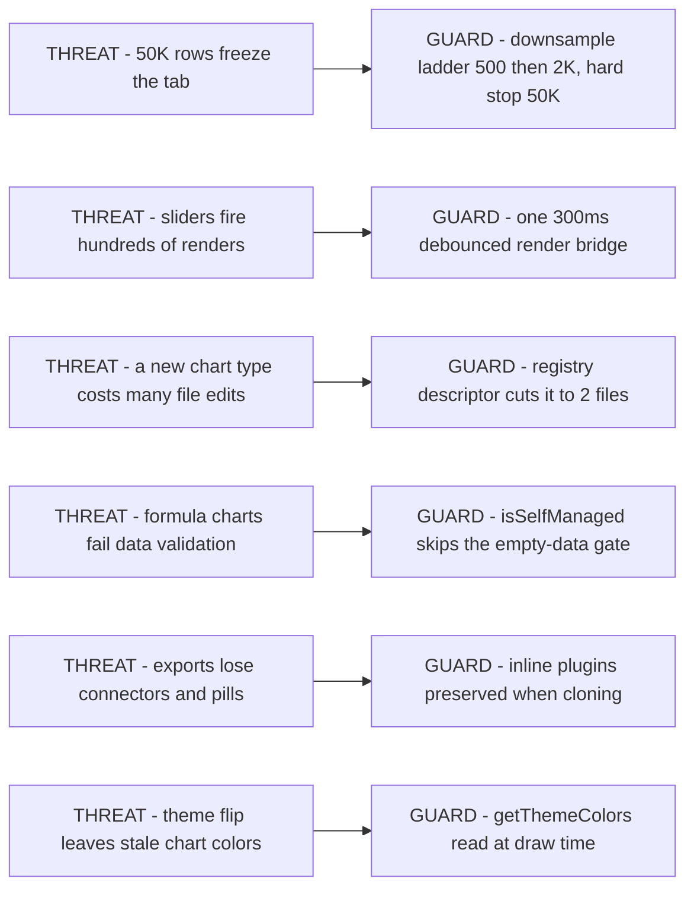
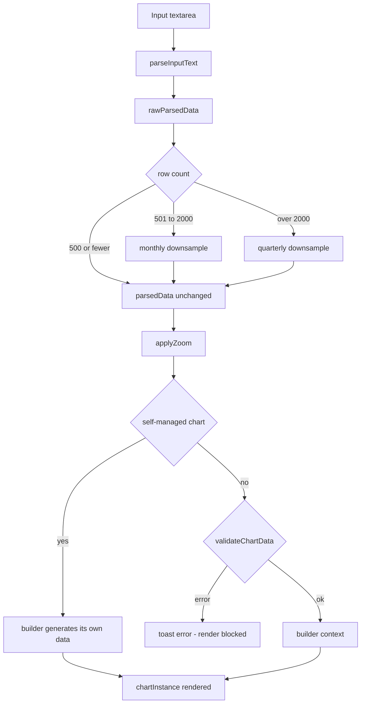
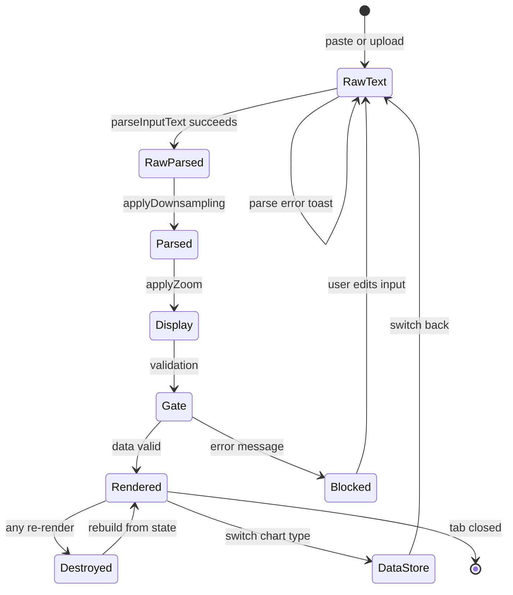
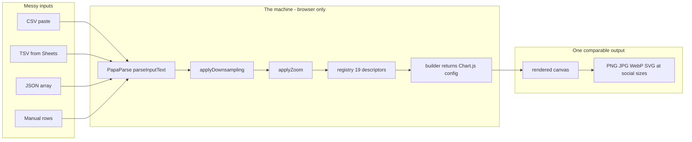
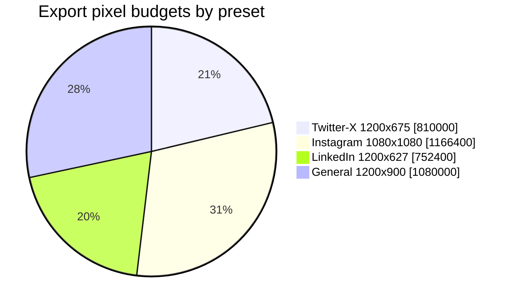
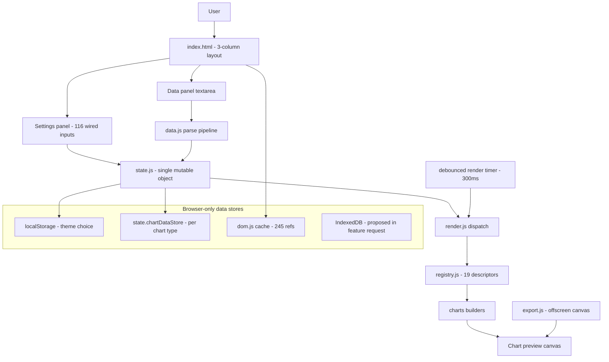

# Simple Charts — Expert-Panel Repository Retrospective

> Plain-text companion to `view-project-story.html` (interactive version: 9 tabs, theme toggle, searchable commit log).
> Generated 2026-08-31 from a full-history forensic pass: **70 commits** (2026-04-16 → 2026-06-29), 1 author, 3 stashes, 6 branches.
> Every claim anchors to a commit hash, `path:line`, stash id, or config key. Where sources disagree, both readings are shown (§8.6).

## Contents

1. [Project 101](#1-project-101)
2. [Timeline: Month by Month](#2-timeline-month-by-month)
3. [Rubric Scorecard](#3-rubric-scorecard)
4. [Fleet and Tooling Roster](#4-fleet-and-tooling-roster)
5. [Trade-off Ledger](#5-trade-off-ledger)
6. [Blocker Post-mortems](#6-blocker-post-mortems)
7. [Commit Log (all 70)](#7-commit-log-all-70)
8. [Data Room](#8-data-room)
9. [Lessons](#9-lessons)

---

## 1. Project 101

### 1.1 The pitch

**Simple Charts answers one question: how do I turn raw spreadsheet data into a branded, publication-quality chart
sized for social media — without installing anything, signing up, or writing code?**

It is a single-page, browser-only studio: paste CSV/TSV/JSON or type rows, pick from **19 chart types**, style it,
drop in a logo, and export PNG/JPG/WebP/SVG at exactly 1200×675 (Twitter/X), 1080×1080 (Instagram), 1200×627
(LinkedIn) or 1200×900 (general). No backend, no accounts, no telemetry; the only network requests are five pinned
CDN libraries at page load (README.md:35, index.html:55, README "Export & Sharing").

**The moat is the method, not the data.** Generic tools ship line/bar/pie. This app ships the charts analysts
actually argue with: an *Innovator's Dilemma* disruption curve (541 lines of formula-driven geometry,
`src/charts/innovator.js`), a *Kano* feature-prioritization model (402 lines), a segmented-bar editor with
multi-group support, dumbbell / bubble-compare / overlay comparisons on shared log-axis helpers, a dual-bar
target-vs-current chart, and an inflation purchasing-power calculator. Stack: vanilla ES2020+ modules,
Chart.js 4.5.1, PapaParse 5.5.3, plain CSS — zero build step (CLAUDE.md; .agent/rules/rules.md:7-15).

**Who built it and how:** Sanket, solo, 2026-04-16 → 2026-06-29 (70 commits), working AI-assisted. No
Co-Authored-By trailers exist, so attribution is artifact-based: Kilo Code planning files predate the repo
(2026-03-20, `stash@{0}` `.kilo/plans/`) and a committed AI-rules doc governs the codebase (87e9e6a); three
`worktree-agent-*` branches mark Claude Code sessions (§4).

### 1.2 Stack & hosting footprint

| Layer | Choice | Version | Evidence |
|---|---|---|---|
| Language | Vanilla JS, ES modules, no TypeScript | ES2020+ | CLAUDE.md; .agent/rules/rules.md:7 |
| Charts | Chart.js as `window.Chart` CDN global | 4.5.1 | index.html; upgraded from 4.4.7 in ee6a9fd |
| Data labels | chartjs-plugin-datalabels | 2.2.0 | index.html |
| CSV/TSV | PapaParse as `window.Papa` | 5.5.3 | index.html; upgraded from 5.4.1 in ee6a9fd |
| Time axis | chartjs-adapter-date-fns | 3.0.0 | index.html |
| Annotations | chartjs-plugin-annotation | 3.1.0 | index.html |
| CSS | Single plain file, CSS variables, both theme blocks | — | styles.css (1,923 lines) |
| Build | **None** | — | CLAUDE.md "No build system, no npm" |

- **Hosting:** any static file server; `python3 -m http.server 8080` is the documented dev loop (ES modules need http).
- **Monthly cost:** $0 — static hosting only; no servers, no databases, no accounts.
- **Containers / background jobs:** zero containers. Only in-page timers: one 300 ms debounced render
  (`constants.js:51`) and PapaParse web workers.
- **Deployed output:** `dist/` is committed but **60 days stale** (last touched 28e7cd7, 2026-04-30).

### 1.3 The core mechanism

**Data pipeline** (the machine every chart runs through):

```
Input → parseInputText() → rawParsedData → applyDownsampling() → parsedData
      → applyZoom() → validateChartData() → builder → chartInstance
```

One parse pipeline feeds all 19 charts. The registry (`src/charts/registry.js:1`) is the single source of truth:
each chart module registers a descriptor (`id, label, icon, builder, isSelfManaged, capabilities`) at import time,
and `render.js` dispatches with one lookup instead of a 17-branch switch (todo.md "Success Metrics": 17 → 1).

**Worked example — the inflation formula** (the one place the product computes a number for you):

```
equivalent = amount × (1 + r) ^ (target − base)
```

With the shipped sample values — amount **$1,000**, rate **3%**, base year **2026**, target year **2036**:
1000 × 1.03¹⁰ = **$1,343.92** ("what today's money is worth then"). Reverse the years (target 2016) and the same
formula returns 1000 × 1.03⁻¹⁰ = **$744.09** ("what it was worth previously") — both directions supported
(todo.md §8.2). Prototype playground with 8 live variants: `inflation/`; integrated chart: `src/charts/inflation.js`,
registered as `id: 'inflation'`.

**Thresholds & bands** (constants.js:44-52):

| Band | Behavior | Evidence |
|---|---|---|
| ≤ 500 rows | pass through untouched | data.js:23 |
| ≤ 2,000 rows | monthly downsample | data.js:24 |
| > 10,000 rows | warning toast (`warnRowLimit`) | constants.js:45 |
| > 50,000 rows | hard stop (`hardRowLimit`) | constants.js:46 |
| bars / pie / donut | 30 bars max; 12 pie / 10 donut slices | constants.js:47-49 |
| render | 300 ms debounce (`debounceMs`) | constants.js:51 |

**Missing-data behavior & guarantees:** empty or non-numeric data produces a specific per-chart human message from
`validateChartData()` and blocks render with a toast (render.js:66-72). Self-managed charts (innovator, kano,
timeline, dual-bar, inflation) generate their own data when the textarea is empty — validation only runs when parsed
data exists (render.js:40-48). Guarantees: nothing leaves the browser; same input + same settings = same pixels; no
server-side truth to drift.

### 1.4 Why it works — design bets as threat → mechanism pairs

| Threat | Mechanism | Evidence |
|---|---|---|
| Huge pastes freeze the tab | Downsample ladder + hard limits | data.js:23-24; constants.js:45-46 |
| Sliders firing hundreds of renders | One 300 ms debounced render bridge, mandated by convention | constants.js:51; rules.md:85 |
| Every new chart type costs many file edits | Registry + capability auto-discovery cuts it to 2 files | registry.js:13; todo.md Success Metrics (6→2) |
| Formula-driven charts fail data validation | `isSelfManaged` flag + validate-only-when-data | render.js:40-48 |
| Exports lose custom canvas drawings | Inline plugins preserved when the config is cloned | 1d659bc (2026-05-04) |
| Theme flip leaves stale chart colors | `getThemeColors()` read inside `beforeDraw` at draw time | rules.md:111; charts/base-options.js |


*(Diagram 2 of 6 — in the HTML this renders with semantic colors; the source text is the offline fallback.)*

### 1.5 How it works end-to-end

| Step | Module | What happens | On failure |
|---|---|---|---|
| 1. Input | index.html + ui/clipboard.js | Paste, file upload, or manual rows; format toggle csv/tsv/json | — |
| 2. Parse | data.js `parseInputText()` | PapaParse (auto-delimiter) or JSON.parse → `{labels, datasets}` | Toast error, textarea preserved |
| 3. Downsample | data.js `applyDownsampling()` | 500/2,000-row ladder → `rawParsedData` stays pristine | Warning at 10K, hard stop at 50K |
| 4. Zoom | data.js `applyZoom()` | Slices range to the zoom window | — |
| 5. Validate | charts/registry.js `validateChartData()` | Per-chart column/type checks | Warnings pass; errors block render |
| 6. Build | charts/&lt;type&gt;.js builder | Returns full Chart.js config; self-managed charts build their own options + data | — |
| 7. Render | render.js `renderChart()` | Destroys previous `chartInstance`, creates the new one; theme re-read at draw time | — |


*(Diagram 3 of 6 — the pipeline with its two decision gates.)*


*(Diagram 5 of 6 — entity lifecycle of one chart session, including the validation guard (render.js:40-72) and the
per-type data store `state.chartDataStore`.)*


*(Diagram 1 of 6 — the idea: messy inputs in, one comparable branded output out.)*

### 1.6 Repo map (real paths)

| Path | Lines | Role |
|---|---|---|
| index.html | 1,142 | All markup: 3-column layout, every control, CDN tags |
| styles.css | 1,923 | All CSS: tokens → theme blocks → layout → components |
| src/main.js | 460 | Entry: init(), event wiring, sample data |
| src/render.js | 94 | Render dispatcher — registry lookup, not a switch |
| src/state.js | — | Single mutable state; `charts.*` namespace; chartDataStore |
| src/dom.js | 267 | DOM cache, 245 refs queried once at load |
| src/charts/registry.js | 149 | 19 descriptors, capabilities, validateChartData |
| src/charts/base-options.js | 741 | FONTS tokens, tooltip/legend helpers, theme plugins |
| src/charts/*.js (19 builders) | — | One file per chart type; innovator.js 541 lines is the largest |
| src/ui/*.js (13 modules) | — | theme, colors, settings (116 wired inputs), export, branding, dual-axis, … |
| src/data.js | 619 | Parse pipeline, downsampling, zoom |
| inflation/ | — | Standalone 8-variant prototype playground (second app in the repo) |
| dist/ | — | Committed build output, 60 days stale |
| .agent/rules/rules.md | 160 | AI assistant rules — committed 2026-04-27 (87e9e6a) |
| todo.md | 286 | 8-phase plan with checkboxes — the plan-vs-actual record |

### 1.7 Services, data model, API, access

| Service / store | Kind | Limits |
|---|---|---|
| Dev server | Ad-hoc static server (python3 / npx serve / php) | Developer-run, not deployed |
| Containers | **None** | No Dockerfile, no compose file in the repo |
| state.js object | In-memory, single mutable | Cleared on reload; `charts.*` namespaced |
| localStorage | Persistent, tiny | Theme choice only |
| IndexedDB | **Proposed, not built** | feature-request/save-search-request.md |

**API surface:** none public — the app is a page, not a service. The internal surface is the registry contract
(`registerChart / getChartDescriptor / getAllChartDescriptors / getCapabilities / validateChartData`,
registry.js:13-36) plus three `window.__` bridges (`__renderChart`, `__debouncedRender`, `__updateAfterDataLoad`)
that break the import DAG. **Access model:** no auth, no accounts, no network calls after CDN load.

### 1.8 Two-minute reading order & glossary

1. `README.md` — Overview + Architecture + ASCII wireframe (what the product is)
2. `CLAUDE.md` — architecture, conventions, how to add a chart (with §8.6 caveats)
3. `.agent/rules/rules.md` — the design-token and component law
4. `src/charts/registry.js` — the single source of truth
5. `src/render.js` — the whole dispatch in 94 lines
6. `todo.md` — what was planned vs what shipped

**Glossary:** *parsedData* (post-downsample data actually rendered) · *rawParsedData* (pre-downsample original) ·
*chartInstance* (live Chart.js object, destroyed each re-render) · *currentChartType* (string id into the registry) ·
*descriptor / capabilities* (registry entry + feature flags) · *self-managed chart* (builds its own data & options) ·
*downsample* (time-bucketing ladder) · *window.__ bridges* (globals that break the import DAG).

### 1.9 Where the bodies are buried

- **stash@{0} — 4,814 lines**: the entire product documentation set (hub/PRD.md 415, TECHNICAL_SPECIFICATION.md 862,
  USER_MANUAL.md 688, STYLE_GUIDE.md 556), 7 Kilo Code plan files (one dated 2026-03-20 — before the repo exists),
  and an 883-line auto-comparison.html. One `git stash drop` from oblivion.
- **stash@{2} — the abandoned test setup**: test/utilities.test.js (153 lines), package.json, LICENSE and .gitignore —
  none committed to main. The repo has no license file and no tests.
- **dist/ is a false signal**: committed, last built 2026-04-30 (28e7cd7), 60 days behind main.
- **.vite/deps/ is tracked** in a repository whose first law is "no build system, no npm".
- **CLAUDE.md has drifted**: switch-dispatch (it is registry dispatch), missing registry.js/dual-bar.js/inflation.js,
  CDN versions (4.4.7/5.4.1) superseded in ee6a9fd.
- **The brand is forked**: README says "Simple Charts", the stashed PRD says "Charts BeamDelta", and the rename
  commit 8d04f14 sits unmerged on `brand-update`.
- **Small but real**: settings.js duplicates `dom.innovatorDisruptiveStart/Peak` in its 116-entry input array
  (settings.js:253-254); inflation/ is a second app sharing no code with the first.

---

## 2. Timeline: Month by Month

*HTML tab: "Timeline" (filterable by era). All 70 commits appear in §7; this section tells the story, §7 lists the raw log.*

### Prologue — before the repo (2026-03-20 → 2026-04-15)

The repo's first commit is a **squash**: 6,814 lines in one commit (036d040) — a 1,208-line app.js, 344-line
index.html, 887-line styles.css, and a 4,375-line cryptocurrency CSV. History before 2026-04-16 does not exist in
git — but it happened: `stash@{0}` contains a Kilo Code plan dated 2026-03-20
(`.kilo/plans/1773987449-happy-mokey.md`), and five more plans follow through 2026-04-27. The story starts at
chapter two.

- **Chose:** one clean 6,814-line initial commit. **Rejected:** importing real pre-history. **Cost:** ~4 weeks of
  evolution invisible.
- **Sets up:** a clean slate for the April burst — and a permanently invisible pre-history.

### April 2026 — The Big Bang (47 commits, 67% of all history, in 15 days)

**Theme: monolith → machine.** app.js grows 1,208 → 4,417 lines in six days of additive building, then the whole
thing is split into a modular `src/` tree — inside a feature commit. Thirteen chart types, the registry rewrite, the
committed AI-rules doc, and the comparison-chart family all land this month. The app is renamed ChartForge →
Simple Charts on day two (57d7c31).

**Decisions (chosen vs rejected):**
- Build-then-split (additive monolith until 04-21, split on 04-22) vs modular-from-start; cost: 6 days of rework.
- Monolith deletion inside feature commit c025719 vs a separate refactor commit; cost: history reads as if features
  deleted the monolith.
- Registry + capabilities as single source of truth (28e7cd7, 4649433) vs keeping the 6-if/11-case switch; cost:
  3 days with no user-visible feature.
- Commit the AI assistant rules (87e9e6a) vs keeping tool rules local.
- Upgrade CDN deps mid-flight (ee6a9fd) vs pinning docs; cost: docs cite 4.4.7/5.4.1 to this day.
- Delete the 4,375-line crypto CSV (08fea6a) vs keeping demo data in-tree.

**Challenges:** settings visibility via 39 `.includes(t)` calls (replaced by capability flags, todo.md §3.4);
chart-specific state flat on the global object (namespaced in May, 788c2f5); synchronous renders on every tweak
(fixed with the debounced bridge, be14bfc/88f65e8).

**Blockers:** debounce race, act I (be14bfc, 88f65e8); the node_modules mirage (5b8164b, 3f8c9a8 — §6.5).

**Trade-offs:** CDN globals over npm (version drift became real); Chart.js over D3 (speed over ceiling); Bitcoin-orange
brand `#F7931A` (rules.md:57) — strong identity, fails AA on white.

**Evidence:** 036d040, ecb4e2d, 57d7c31, 5b8164b, ba28153, be14bfc, 88f65e8, f93e364, 1737ac9, 08fea6a, d50fb7b,
c025719, 9135a51, 87e9e6a, ee6a9fd, c133e42, f4cd692, 28e7cd7.

**Sets up:** the registry makes the next 6 chart types ~2-file additions; the committed rules doc makes AI-assisted
work consistent. April proves a solo + AI fleet can ship a differentiated product in 15 days — not that it can
maintain one.

### May 2026 — Consolidation (19 commits, front-loaded into two days)

**Theme: quality, export fidelity, and the platform.** A four-day sprint (May 1-4) lands the export pipeline, data
export formats, JSDoc sweep, validation, and per-chart state namespacing. Then a 7-day silence, a two-day
axis-formatting pass (May 12-13), and another 29-day silence.

**Decisions:** registry-native validation with per-chart messages (788c2f5) vs silent best-effort rendering; preserve
inline plugins on export clone (1d659bc) vs re-drawing after export; flip default theme to light (0c9b43f) vs
dark-first; defer the test suite (stash@{2}) vs committing it.

**Challenges:** self-managed charts blocked by the validation gate — fix shipped in render.js:40-48 yet todo.md §5.1
is still unchecked (§8.2); export fidelity until inline-plugin preservation landed.

**Blockers:** debounce race, act II (dfc2798, 2026-05-04 — same bug class, one month later); radar axis hardcoded at
`suggestedMax: 100` (ad7bac1); segmented validation too strict (150feb4).

**Trade-offs:** warning-vs-error decided by message sniffing (`err.includes('ignored')`, render.js:47) vs structured
errors; per-chart data cache costs memory; JSDoc everywhere instead of tests.

**Evidence:** 150feb4, c589cbf, 1d659bc, 4791d71, a3aace2, dfc2798, 788c2f5, ad7bac1, cb03c7e, 474b8c3.

**Sets up:** per-axis formats and log-scale ticks make the engine credible for real analyst data. May proves the
platform can absorb hardening — but sustained maintenance never arrives.

### June 2026 — The long tail (4 commits, −89% velocity)

Two commits on Jun 13 (waterfall polish 7806271; dual-bar 78b7eb8 — the first chart written registry-native from
birth), a 16-day gap, then two on Jun 29: the standalone inflation gallery (`inflation/`, 8 live variants) and its
integrated Value-Track chart (28e81d4), closed by the README update (4b236bb). The last commit is documentation —
the code had already stopped moving.

**Decisions:** ship new chart shapes over the save/search library (designed in
feature-request/save-search-request.md, unbuilt); prototype inflation as a standalone second app then integrate one
variant; merge via fast-forward from `feat/inflation-chart` (the only branch ever fully merged).

**Trade-offs:** velocity decay 61 commits/19 days → 9 commits/56 days; each new chart still touches dom.js,
settings.js, main.js despite the registry — the 2-files-per-chart promise holds only for the chart module itself
(todo.md §7.5, §8.2 wiring lists).

**Evidence:** 7806271, 78b7eb8, 28e81d4, 4b236bb.

**Sets up:** the current fork — persistence (save/search, designed) vs more chart types (shipped). The repo stops
exactly at the decision point.

---

## 3. Rubric Scorecard

*HTML tab: "Rubric scorecard" (animated bars). Unweighted mean: **6.7 / 10**.*

| # | Rubric | Score | Justification | Evidence |
|---|---|---|---|---|
| 1 | Architecture discipline | 9 | Strict DAG with documented `window.__` bridges, named exports only, 245-ref DOM cache queried once, registry as single source of truth. The 94-line dispatcher proves the architecture is real. | registry.js:1-36; render.js; todo.md Success Metrics |
| 2 | Refactor courage & timing | 8 | Splitting a 4,417-line monolith at day 6 and rewriting dispatch into a registry at week 2 took judgment. Deduction: both refactors hide inside feature commits. | c025719; 28e7cd7 + 4649433 |
| 3 | State & data model | 7 | Single mutable state with `charts.*` namespacing is coherent and fast. Cost: UI truth lives in ~116 DOM inputs, which is why save/search was designed but not built. | 788c2f5; settings.js:236-281; feature-request doc |
| 4 | Testing | 2 | Zero committed tests at 12,844 LOC. The intent existed — 153-line suite + package.json in stash@{2}. The two debounce fixes and the export bug are the receipts. | stash@{2}; CLAUDE.md "No test suite exists" |
| 5 | Documentation | 7 | 730-line README with wireframe and ToC, 160-line AI-rules doc, JSDoc sweep. But docs rot: CLAUDE.md wrong on dispatch/versions/file list; PRD stashed; "14 types" of 19. | README.md; 87e9e6a; f93e364; §8.6 |
| 6 | DX / onboarding | 9 | No build, no install, no accounts: clone, run one static server, open the page. Registry-driven per-chart format hints self-document inputs. | CLAUDE.md; todo.md §3.3 |
| 7 | Dependency discipline | 8 | Five runtime CDN deps, all pinned, zero npm runtime deps. Deduction: mid-flight upgrade unrecorded; `.vite/deps/` still tracked. | index.html; ee6a9fd |
| 8 | Performance engineering | 7 | Real ladder (500/2,000 downsampling, 10K warn, 50K stop), 300 ms debounce, zoom, offscreen export canvas. Deduction: thresholds only, no measurement culture. | data.js:23-24,530-532; ui/export.js:133-153 |
| 9 | Guardrails & validation | 7 | Per-chart validation with actionable messages plus canvas limits. Deduction: warning-vs-error decided by sniffing substrings (render.js:47,69). | registry.js; constants.js:47-49 |
| 10 | Git hygiene | 4 | Conventional prefixes used (52 feat / 6 fix / 2 docs / 1 each refactor, chore, clean up, update / 6 untyped), but two commits describe work never committed; no LICENSE or .gitignore on main. | 5b8164b, 3f8c9a8; stash@{2} |
| 11 | Release hygiene | 3 | dist/ committed and 60 days stale; no tags, no CI, no release notes. | git log -- dist; git tag (empty) |
| 12 | Scope discipline | 6 | 19 chart types + export/branding/zoom/dual-axis/inflation in 75 days, all cohesive. Breadth-first: every feature 80% deep; persistence designed and shelved; a second app now in-tree. | README.md:35; inflation/ |
| 13 | Velocity | 9 | 61 commits in 19 days (3.2/day), solo, including 13 chart modules and two refactors. The fades are rest, not thrash: zero reverts, zero force-pushes. | git log; reflog |
| 14 | AI-assisted workflow maturity | 8 | Committed AI rules, mandated todo.md discipline, Kilo plans predating the repo, worktree branches — a governable fleet. Deduction: zero attribution trailers; §5.5 browser testing left unchecked. | 87e9e6a; stash@{0}; rules.md:157-161 |

---

## 4. Fleet and Tooling Roster

*HTML tab: "Fleet roster". Git shows one author and zero attribution trailers; the roster is reconstructed from
artifacts and labeled as inference.*

| Member | Basis | Evidence |
|---|---|---|
| **Sanket** (human) | Sole git author, 70/70 commits, 2026-04-16 → 2026-06-29; authored the plan discipline (todo.md, 8 phases) | `git shortlog -sne` |
| **Kilo Code** (AI, inferred) | Seven `.kilo/plans/*.md` files in stash@{0}, earliest dated 2026-03-20 (4 weeks before the first commit); committed rules doc "for Simple Charts AI Assistant"; the two "kilo dependencies" commits; hub/ docs produced in this window and stashed | stash@{0}; 87e9e6a; 5b8164b, 3f8c9a8 |
| **Claude Code** (AI, inferred) | Three `worktree-agent-*` branches (a7e440a1, adebde9f, ae9bde8c) all at c133e42 — sessions that produced no commits, only scars; CLAUDE.md; the feature-request analysis doc's design-documentation style | branch registry (§8.5) |

Signals: zero Co-Authored-By trailers (`git log --format=%B | grep -i co-authored` → empty) — attribution cannot be
read from history; todo.md discipline is *mandated* by rules.md:157-161, i.e. process enforced on human and AI
contributors alike.

---

## 5. Trade-off Ledger

*HTML tab: "Trade-off ledger".*

| # | Choice | Alternative | Cost paid | Verdict |
|---|---|---|---|---|
| 1 | Five pinned CDN globals | npm + bundler + lockfile | Docs drifted from real versions | Right call |
| 2 | Vanilla ES modules, no framework | React/Vue + store | Manual render triggers; `window.__` bridges | Right call |
| 3 | Single mutable state, DOM read at render | Framework-style owned state | ~116 inputs of UI truth in the DOM | Fine until it wasn't |
| 4 | Build-then-split monolith | Modular from commit one | 6 days rework; split hidden in feature commit | Velocity won, history lost |
| 5 | Registry rewrite at week 2 | Keep switch dispatch | 3 days, zero visible features | Paid off measurably |
| 6 | Self-managed chart pattern | Uniform data-driven builders | Two render lifecycles; special validation | Necessary for formula charts |
| 7 | Squashed initial commit | Import real history | ~4 weeks pre-history invisible | Pragmatic, lossy |
| 8 | Product docs stashed, not committed | Commit hub/ | CLAUDE.md references a missing directory | Accident — unstash it |
| 9 | Commit dist/ | Build on release / ignore | 60-day stale build as false signal | Drop or automate |
| 10 | Abandon the test setup | Commit stash@{2}'s suite | Zero regression safety; bugs fixed twice | Biggest debt |
| 11 | Refactor inside feature commit c025719 | Separate refactor commit | History cannot show refactor cost | Velocity over hygiene |
| 12 | Upgrade CDN deps mid-flight | Pin + update docs together | Docs still cite old versions | Forgotten follow-up |
| 13 | Bitcoin-orange `#F7931A` brand | Neutral accessible palette | Brand hue fails AA on white | Identity vs contrast |
| 14 | Warning-vs-error by message sniffing | Structured error objects | Brittle string coupling | Shipped-fast compromise |
| 15 | Hard guardrails (50K/30/12/10) | Unlimited input | Power users blocked | Protects the product |
| 16 | Per-chart data store on type switch | One shared dataset | Memory; more state to serialize | Preserves user work |
| 17 | Rename twice; park BeamDelta on a branch | Pick one name | PRD brand ≠ product brand; 8d04f14 stranded | Unresolved |
| 18 | Design save/search, ship charts instead | Build persistence now | The moat-extender waits | Documented fork |

---

## 6. Blocker Post-mortems

*HTML tab: "Blocker post-mortems".*

### 6.1 Exports silently lost custom drawings — 1d659bc (2026-05-04)
**Broke:** dumbbell connectors, bubble-compare arrows, ratio pills vanished from exported PNGs. **Why:** `doExport()`
replaced the entire plugins array, dropping chart-specific inline plugins (todo.md §4.1). **Fix:** clone the config but
preserve inline plugins, replacing only shared ones. **Lesson:** config cloning must be identity-preserving for
chart-specific extensions.

### 6.2 The debounce race, fixed twice — be14bfc, 88f65e8 (Apr 19-20); dfc2798 (May 4)
**Broke:** color/zoom re-rendered synchronously; a month later segmented group updates still did. **Why:** render
trigger is a judgment call at every call site — no single policy. **Fix:** `window.__debouncedRender()` became the
convention (rules.md:85 mandates it). **Lesson:** a bug fixed twice in two weeks is a missing convention, not two bugs.

### 6.3 Radar chart clamped at 100 — ad7bac1 (2026-05-12)
**Broke:** radar data above 100 rendered wrong. **Why:** `suggestedMax: 100` hardcoded in shared options. **Fix:**
`beginAtZero: true`. **Lesson:** magic numbers in shared options silently clamp user data — defaults must derive from
the data.

### 6.4 Validation gate blocked self-managed charts — render.js:40-48
**Broke:** innovator/kano/timeline hit "No data to render" with an empty textarea. **Why:** one validation path for
two chart lifecycles. **Fix:** validate only when `state.parsedData` exists. **Lesson:** a gate needs lifecycle
awareness. *Post-script:* the fix is in the code, yet todo.md §5.1 remains unchecked — plan and code disagree (§8.2).

### 6.5 The node_modules mirage — 5b8164b, 3f8c9a8 (2026-04-17)
**Broke:** nothing user-facing — but two commits titled "add Zod v4 and Kilocode SDK dependencies to project
node_modules" and "update kilo dependencies and sync zod v3/v4 modules" contain only app.js / index.html / styles.css
diffs; no node_modules, package.json, or lockfile was ever tracked. **Why:** an experiment abandoned within hours;
titles written for work that never landed. **Fix:** dropped; residue `.vite/deps/` still tracked. **Lesson:** commit
messages are documentation — in an AI-assisted fleet, verify the diff against the title.

### 6.6 The 6,814-line first breath — 036d040 (2026-04-16)
**Broke:** nothing — but the "initial commit" is a squash (1,208-line app.js, full styles/markup, and a 4,375-line
cryptocurrency CSV), and a Kilo plan dated 2026-03-20 proves the missing weeks. **Fix:** CSV deleted eight days later
(08fea6a). **Lesson:** the repo starts at chapter two of this story.

---

## 7. Commit Log (all 70)

*HTML tab: "Commit log" (searchable, month-filterable). Subjects verbatim; types derived from prefixes.*

| Hash | Date | Type | Subject |
|---|---|---|---|
| 036d040 | 2026-04-16 | untyped | initial commit |
| ecb4e2d | 2026-04-16 | feat | feat: Enhance chart configuration options and UI improvements |
| 57d7c31 | 2026-04-17 | feat | feat: Update branding from ChartForge to Simple Charts across application |
| 5b8164b | 2026-04-17 | feat | feat: add Zod v4 and Kilocode SDK dependencies to project node_modules |
| 3f8c9a8 | 2026-04-17 | chore | chore: update kilo dependencies and sync zod v3/v4 modules |
| 5e01afe | 2026-04-18 | untyped | Enhance accessibility and improve UI/UX |
| 9bb213c | 2026-04-18 | fix | fix: update export configuration to use chartInstance.config._config and clarify CSS opacity handling |
| ba28153 | 2026-04-19 | feat | feat: implement Innovator's Dilemma chart with customizable settings and UI components |
| 3794e0d | 2026-04-19 | feat | feat: implement dynamic settings visibility based on selected chart type |
| e9e895e | 2026-04-19 | feat | feat: add support for innovator chart zooming and improve zoom slider UI positioning |
| 275a179 | 2026-04-19 | feat | feat: enhance Innovator's Dilemma chart with additional settings and improved UI components |
| 67a0380 | 2026-04-19 | feat | feat: enhance innovator chart settings and add timeline event markers |
| be14bfc | 2026-04-19 | feat | feat: increase debounce time for rendering and implement debounced rendering in chart updates |
| 88f65e8 | 2026-04-20 | feat | feat: replace renderChart with debouncedRender for improved performance during color and zoom adjustments |
| 4547569 | 2026-04-20 | feat | feat: add JSON data parsing support and format toggle in data input |
| cb17aa8 | 2026-04-20 | feat | feat: add combo chart type support and dataset type toggles in settings |
| f93e364 | 2026-04-20 | feat | feat: add detailed JSDoc comments for constants, functions, and event handlers in app.js |
| b7c60ed | 2026-04-21 | feat | feat: add segmented bar chart support with customizable segments and settings |
| 59cba33 | 2026-04-22 | feat | feat: add segmented bar chart section to README and update chart count in overview |
| 1737ac9 | 2026-04-22 | feat | feat: implement SVG logo upload and display functionality with customizable placement options |
| 435dcdf | 2026-04-22 | feat | feat: update README to reflect support for 13 chart types and enhance brand logo upload details |
| 08fea6a | 2026-04-22 | clean up | clean up: removed unused file |
| d50fb7b | 2026-04-22 | feat | feat: add multi-group support for segmented bar charts with UI elements for group management |
| c025719 | 2026-04-22 | feat | feat: add branding, clipboard, color pickers, and dual-axis functionality |
| 3f6cdbb | 2026-04-23 | feat | feat: implement line style customization for area and line charts with UI controls |
| 9135a51 | 2026-04-24 | feat | feat: add Kano Model chart with UI settings and data parsing functionality |
| 3657655 | 2026-04-26 | fix | fix: correct formatting in README for data input options |
| ee6a9fd | 2026-04-27 | feat | feat: update Chart.js and PapaParse versions; enhance timeline chart event handling |
| 87e9e6a | 2026-04-27 | docs | docs: add comprehensive rules and guidelines for Simple Charts AI Assistant |
| 014a274 | 2026-04-27 | feat | feat: enhance combo chart support in settings and data options |
| 6420329 | 2026-04-27 | feat | feat: add segmented bar JSON format tooltip and enhance data handling for segmented charts |
| 7255754 | 2026-04-28 | feat | feat: enhance info tip display for segmented charts with additional data format labels |
| 0aeb273 | 2026-04-28 | feat | feat: enhance data visibility handling in chart options and improve legend click behavior |
| bf1f7a0 | 2026-04-28 | feat | feat: add options for displaying numbers and minimum label percentage in segmented charts |
| b596e17 | 2026-04-28 | feat | feat: enhance segmented bar chart to support number display and minimum label percentage |
| 29f721c | 2026-04-28 | feat | feat: refactor segment border radius calculation for dynamic visibility in segmented bar chart |
| 405c9be | 2026-04-28 | feat | feat: implement percentage mode for segment values in segmented charts |
| c133e42 | 2026-04-29 | feat | feat: enhance Y-axis buffer handling for dual-axis charts and add logarithmic tick generation |
| 84d7dc1 | 2026-04-29 | docs | docs: update repository clone URL in README |
| f4cd692 | 2026-04-29 | feat | feat: add dumbbell, bubble compare, and overlay chart types with corresponding settings and rendering logic |
| 4be16cf | 2026-04-30 | feat | feat: Enhance comparison charts with new features and improvements |
| 67756a2 | 2026-04-30 | feat | feat: add documentation for new chart types: dumbbell, bubble compare, and overlay |
| 4649433 | 2026-04-30 | untyped | Refactor chart options and enhance functionality |
| ec6602e | 2026-04-30 | feat | feat: enhance line style controls and add semantic color variables in CSS |
| 28e7cd7 | 2026-04-30 | untyped | Refactor chart state management and registration |
| 63e99e5 | 2026-04-30 | feat | feat: update README and add todo for chart registration system enhancements |
| 0c9b43f | 2026-04-30 | feat | feat: switch theme to light mode and update color variables for better visibility |
| 4cd5c9b | 2026-05-01 | fix | fix: hide grid lines on overlay chart for cleaner visualization |
| d67c09c | 2026-05-01 | feat | feat: enhance donut chart options and update data hint for clarity |
| f6cf261 | 2026-05-01 | untyped | Enhance chart data handling and user experience |
| 150feb4 | 2026-05-01 | fix | fix: update validation for segmented chart to require at least 1 value column |
| d7a35dc | 2026-05-02 | feat | feat: TODO.md added - enhance chart registration with data validation and improved user feedback |
| 96ba9f3 | 2026-05-03 | feat | feat: enhance data input options and update format handling for improved user experience |
| c589cbf | 2026-05-03 | feat | feat: add data export options for CSV, TSV, and JSON formats with copy functionality |
| e9057ad | 2026-05-03 | feat | feat: add panel title actions with format options and copy functionality |
| ba594be | 2026-05-04 | update | update: update default export quality to 1x in export options |
| 1d659bc | 2026-05-04 | feat | feat: preserve inline plugins in chart exports to fix missing elements |
| 4791d71 | 2026-05-04 | feat | feat: enhance innovator chart with data-driven input and auto-scaling for Y-axis |
| a3aace2 | 2026-05-04 | untyped | Add documentation comments for chart-related modules and functions |
| dfc2798 | 2026-05-04 | fix | fix: use debounced render function for segmented group updates; add missing documentation in timeline UI |
| 788c2f5 | 2026-05-04 | refactor | refactor: restructure todo.md for modular architecture; enhance chart registration and validation features |
| ad7bac1 | 2026-05-12 | fix | fix: update radar chart axis to auto-scale by replacing suggestedMax with beginAtZero |
| cb03c7e | 2026-05-12 | feat | feat: add axis formatting options for dual-axis UI; update state management for axis formats |
| a0f7b66 | 2026-05-12 | feat | feat: enhance Y-axis tick formatting by allowing override options and integrate formatting in Innovator's Dilemma chart |
| b625be1 | 2026-05-13 | feat | feat: add Y-axis scale selection for Innovator's Dilemma chart; implement linear and logarithmic scaling options |
| 474b8c3 | 2026-05-13 | feat | feat: implement logarithmic scale support for Y-axis tick formatting in charts |
| 7806271 | 2026-06-13 | feat | feat: update waterfall chart colors and legend configuration for improved clarity |
| 78b7eb8 | 2026-06-13 | feat | feat: add dual-bar chart implementation with customizable settings and validation |
| 28e81d4 | 2026-06-29 | feat | feat: add inflation calculator with interactive charts and controls |
| 4b236bb | 2026-06-29 | feat | feat: update README with new chart types and features; add dual-bar chart and combo chart descriptions |

Type mix: feat 52 · fix 6 · docs 2 · untyped 6 · refactor 1 · chore 1 · clean up 1 · update 1 = 70.
Note the lone "update:" — a type outside the documented vocabulary (rules.md:140).

---

## 8. Data Room

### 8.1 Cadence

| Month | Commits | Active days | Silent stretches |
|---|---|---|---|
| April 2026 | 47 | 14 of 15 (Apr 16-30) | only Apr 25 |
| May 2026 | 19 | 6 | May 5-11 (7d), May 14-31 (18d) |
| June 2026 | 4 | 2 | Jun 1-12 (12d), Jun 14-28 (15d) |

61 of 70 commits (87%) land in the first 19 days. Commits per active day:
Apr 16:2 · Apr 17:3 · Apr 18:2 · Apr 19:6 · Apr 20:4 · Apr 21:1 · Apr 22:6 · Apr 23:1 · Apr 24:1 · Apr 26:1 ·
Apr 27:4 · Apr 28:6 · Apr 29:3 · Apr 30:7 · May 1:4 · May 2:1 · May 3:3 · May 4:6 · May 12:3 · May 13:2 ·
Jun 13:2 · Jun 29:2.

### 8.2 Plan vs actual (todo.md, all 8 phases)

| Phase | Dates in plan | Checkbox status | Finding |
|---|---|---|---|
| 1 · Modular architecture | 04-16 → 04-28 | 5/5 done | Verified: src/ exists; monolith deleted in c025719 |
| 2 · Comparison charts | 04-29 → 04-30 | 5/5 done | Verified: f4cd692 (dumbbell, bubble-compare, overlay, compare-utils) |
| 3 · Chart registration | 04-30 → 05-02 | 11/11 done | Verified: registry.js + metrics (39→0 includes, 17→1 branches) |
| 4 · Export & data pipeline | 05-03 → 05-04 | 8/8 done | Verified: TSV/JSON I/O, inline plugin fix (1d659bc) |
| 5 · Innovator data + auto-scale | 05-04 | **3/5 checked** | **Conflict:** §5.1 unchecked but its fix ships in render.js:40-48; §5.4 hints and §5.5 browser testing genuinely open |
| 6 · Docs & polish | 05-04 | 2/2 done | Verified: f93e364, a3aace2, ad7bac1 |
| 7 · Axis formats, log scale, dual-bar | 05-12 → 06-13 | 5/5 done | Verified: cb03c7e, a0f7b66, b625be1, 474b8c3, 78b7eb8 |
| 8 · Inflation | 06-29 | 2/2 done | Verified: inflation/ gallery + charts/inflation.js (28e81d4) |

### 8.3 Migration timeline

| When | Migration | Commit | Measured effect |
|---|---|---|---|
| 2026-04-22 | Monolith app.js (4,417 lines) → src/ module tree | c025719 | 45 JS files, 7,537 src LOC; strict DAG + bridges |
| 2026-04-30 | Switch dispatch → chart registry + capabilities | 28e7cd7 | 17 branches → 1 lookup; 39 `.includes` → 0 |
| 2026-05-04 | Flat chart state → state.charts.* namespacing | 788c2f5 | 7 flat props → 0; per-chart validation live |
| 2026-06-13 | First registry-native chart (dual-bar) | 78b7eb8 | Charts self-register via side-effect import |

### 8.4 The stash museum

| Stash | Contents | Significance |
|---|---|---|
| stash@{0} "temp files" (on brand-update) | **4,814 lines, 12 files**: hub/PRD.md (415), hub/TECHNICAL_SPECIFICATION.md (862), hub/USER_MANUAL.md (688), hub/STYLE_GUIDE.md (556), 7 .kilo/plans/*.md (1,410), auto-comparison.html (883) | The product's entire written strategy, invisible to every repo reader — and the only proof of pre-March work |
| stash@{1} "dotted + dashed lines" (on main) | 145 lines, 9 files: line.js, radar.js, main.js, settings.js, styles.css | Unfinished dash-pattern feature, abandoned mid-flight (line styles shipped separately in 3f6cdbb) |
| stash@{2} "improvements and line + bar chart" (on main) | 544+/247−, 7 files: app.js rework (513), package.json (18), test/utilities.test.js (153), LICENSE (21), .gitignore (8) | The counterfactual repo: license, ignore rules, manifest, and a test suite — one `git stash pop` away |

### 8.5 Branch registry

| Branch | Status | Evidence |
|---|---|---|
| main | active tip | 4b236bb, 2026-06-29 |
| brand-update | 1 ahead, 9 behind | Holds only 8d04f14 (BeamDelta rename) — unmerged |
| feat/inflation-chart | fully merged | Empty main..range; fast-forward merge (reflog HEAD@{0}) |
| worktree-agent-a7e440a1 / -adebde9f / -ae9bde8c | empty scars | All point at c133e42 (in main); no unique commits |
| origin/main | in sync | Remote exists; tags: none |
| origin/feat/inflation-chart | stale remote | Merged content; branch not deleted remotely |

### 8.6 Discrepancy register (unresolved)

| # | Sources disagree | Reading A | Reading B | Stance |
|---|---|---|---|---|
| 1 | CLAUDE.md vs working tree | "hub/ contains product docs" | No hub/ in tree; docs only in stash@{0} | Docs are stashed; CLAUDE.md wrong today |
| 2 | CLAUDE.md vs render.js | "dispatches via switch" | Registry lookup, no switch (render.js:7,35) | Code wins; CLAUDE.md predates Phase 3 |
| 3 | CLAUDE.md/rules.md vs index.html | Chart.js 4.4.7, PapaParse 5.4.1 | 4.5.1 / 5.5.3 since ee6a9fd | Markup wins; docs stale |
| 4 | rules.md vs registry | "14 types" | 19 registered charts | Registry wins |
| 5 | todo.md §1.1 vs git | "app.js (4700+ lines)" | Measured 4,417 lines pre-deletion | Both may be true (uncommitted tree); reported as-is |
| 6 | todo.md §5.1 checkbox vs code | Unchecked (pending) | Fix ships in render.js:40-48 | Code wins; checkbox stale |
| 7 | README vs PRD vs branch | "Simple Charts" (main) | "Charts BeamDelta" (PRD; 8d04f14 on brand-update) | Genuine open brand fork — reported, not averaged |
| 8 | CLAUDE.md (~190 dom refs) vs todo.md (~229) vs measured | "~190 refs" | 245 `key:` lines in dom.js | Measured value wins |

### 8.7 Configured values & the whole system


*(Diagram 4 of 6 — the real configured export presets (README "Export & Sharing", index.html:55) as canvas pixels
per export. Total: 3,808,800 px.)*


*(Diagram 6 of 6 — the whole system: user flow, stores, the one background timer. No servers, no databases, no
containers.)*

---

## 9. Lessons

*HTML tab: "Lessons".*

1. **The highest-leverage refactor is the one you can measure.** The registry rewrite "cost" three feature-less days
   and returned 39→0 `.includes`, 17→1 dispatch branches, 6→2 files per new chart — numbers the team wrote down
   (todo.md Success Metrics).
2. **Build-then-split works — if you split within a week.** The monolith lived six days and 4,417 lines (c025719).
3. **A stash is not a backup.** 4,814 lines of strategy, a test suite, a license, and a .gitignore live in three
   stashes — one `git stash drop` from oblivion.
4. **Commit messages that describe work that never landed are worse than none** (5b8164b, 3f8c9a8).
5. **If UI truth lives in the DOM, persistence gets expensive.** ~116 settings inputs are read from the form at render
   time — which is why save/search became a form-serialization project (feature-request/save-search-request.md).
6. **A bug fixed twice is a missing convention** — the durable fix was the rule at rules.md:85, not the patch.
7. **Docs rot faster than code.** CLAUDE.md was wrong on four facts within eleven weeks (§8.6).
8. **Zero tests is a decision — even an unmade one.** The abandoned suite in stash@{2} proves the intent existed;
   every export and axis bug was found by eye (1d659bc, ad7bac1).
9. **Formula charts need their own lifecycle, not an exception** — `isSelfManaged` made the difference structural
   (render.js:40-48).
10. **Velocity decays unless the queue is real.** 3.2 commits/day for 19 days, then −89%; the repo stops exactly
    where the queue stops — at the save/search fork.

---

*Generated 2026-08-31 by repo-story. Interactive version with theme toggle, animated scorecard, searchable commit log,
and rendered diagrams: `view-project-story.html`.*
